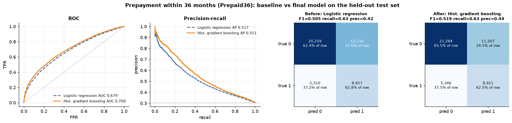
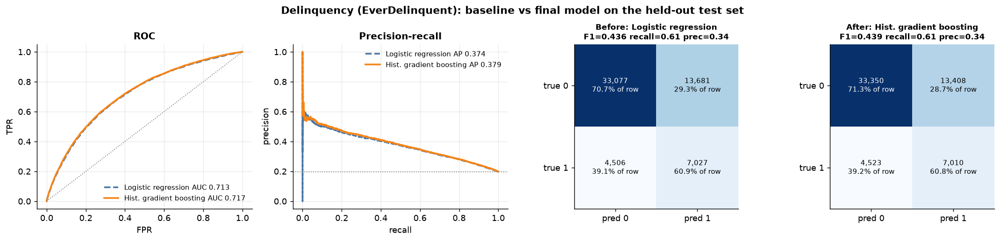
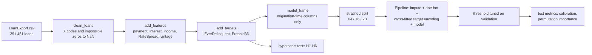

# Mortgage Prepayment Risk

Delinquency and prepayment-risk modelling on 291,451 Freddie Mac fixed-rate mortgages.

Investors in mortgage-backed securities carry two borrower risks: **credit risk** (the borrower
stops paying) and **prepayment risk** (the borrower pays the loan off early, usually by
refinancing when rates fall, returning principal exactly when it can only be reinvested at lower
yields). This project builds a leakage-free pipeline that scores both risks from information
available at origination, measures how far such a score can go, and checks six hypotheses about
what drives prepayment against the data.

## Results

Held-out test set (20%, stratified), models fitted on 64% and thresholds tuned on a separate 16%.

| Task | Positives | Baseline (logistic regression) | Final model (hist. gradient boosting) |
|---|---|---|---|
| Delinquency, `EverDelinquent` (58,291 test loans) | 19.8% | ROC-AUC 0.713, PR-AUC 0.374, F1 0.436 | **ROC-AUC 0.717, PR-AUC 0.379, F1 0.439** |
| Prepayment within 36 months, `Prepaid36` (46,758 test loans) | 30.5% | ROC-AUC 0.679, PR-AUC 0.517, F1 0.505 | **ROC-AUC 0.700, PR-AUC 0.551, F1 0.519** |

The majority-class baseline scores ROC-AUC 0.500 and F1 0.000 on both tasks. Random forest and
XGBoost land within 0.004 ROC-AUC of gradient boosting; 3-fold cross-validation gives the same
numbers to ±0.003. Full tables (precision, recall, Brier score, CV): [docs/results.md](docs/results.md).

### Before vs after

Baseline logistic regression (dashed) vs the final gradient-boosting model on the same test loans.




### Key findings

* **Credit score is almost the whole delinquency story.** Shuffling it drops ROC-AUC by 0.153;
  the next feature drops it by 0.011. Delinquency falls from 41.1% (score < 650) to 9.1% (750+).
  Because the signal is nearly linear, gradient boosting gains only +0.004 AUC over logistic regression.
* **Prepayment is driven by the rate, LTV and the seller.** Loans in the top rate quintile
  (> 7.125%) prepaid within 36 months at 42.9%, against 24.7% for the lowest (<= 6.75%).
  One seller code (`FI`) shows a 57.3% prepayment rate against 17-31% for every other seller.
* **The scores rank well even with modest AUCs.** The riskiest 10% of loans by score are
  delinquent at 45.8% vs 5.6% for the safest 10%; for prepayment, 71.1% vs 12.3%.
* **Origination data caps accuracy near 0.70-0.72 ROC-AUC.** Both outcomes depend mostly on
  what happens after origination (market rates, house prices, unemployment), which a static
  loan-level model cannot see.
* **Leakage matters.** `MonthsDelinquent > 0` is identical to `EverDelinquent = 1` in all 291,451
  loans, so the original notebook's feature set would score a perfect, meaningless 1.0. It is
  excluded, together with `MonthsInRepayment` (post-origination), IDs and the servicer name.

### Hypotheses from the original notebook

| | Hypothesis | Verdict | 36-month prepayment rate |
|---|---|---|---|
| H1 | Lower credit score -> more prepayment | supported | 35.5% (< 650) vs 27.2% (750+) |
| H2 | Higher LTV -> more prepayment | supported | 26.0% (<= 60) vs 32.8% (> 90) |
| H3 | Investment properties prepay more | no material effect | 31.0% vs 30.5% |
| H4 | ARMs prepay more than FRMs | not testable | every loan is fixed-rate |
| H5 | Higher DTI -> more prepayment | supported | 25.1% (<= 20) vs 31.5% (> 40) |
| H6 | Lower origination rate -> more prepayment | **contradicted** | 24.7% (lowest rates) vs 42.9% (highest) |

Verdicts use a 2-percentage-point effect-size rule (with 233,788 loans every p-value is tiny).
H6 is the largest effect and runs the opposite way: borrowers who locked in a high rate gained
the most from refinancing when rates fell in 2001-2003.


## Dataset

`LoanExport.csv`: 291,451 loans x 28 columns, an extract of the
[Freddie Mac Single-Family Loan-Level Dataset](https://www.freddiemac.com/research/datasets/sf-loanlevel-dataset)
(99% of first payments between February and June 1999, performance observed to about 2016).
The full file is not stored here: `python scripts/download_data.py` fetches it (37 MB) from a
public copy into `data/raw/`. A 5,000-row stratified sample in [`data/sample/`](data/sample/)
lets tests and examples run offline. Column meanings, missing-value codes and how each column is used:
[docs/data_dictionary.md](docs/data_dictionary.md).

**Prepayment target.** The file has no loan-status column, so prepayment is derived:
`Prepaid36 = 1` when a never-delinquent loan left the pool within 36 months of its first payment
(the data runs long enough that no loan is censored before month 36). Ever-delinquent loans are
excluded from this task because their early exit may be a default. The reasoning and the
assumptions are in [docs/methodology.md](docs/methodology.md).

## Pipeline



## Quickstart

```bash
git clone https://github.com/benisalla/mortgage-prepayment-risk.git
cd mortgage-prepayment-risk
python -m venv .venv && source .venv/bin/activate
pip install -e ".[dev]"

pytest                                 # 19 tests on the sample, a few seconds
python scripts/download_data.py        # downloads the full data (37 MB) into data/raw/
python scripts/make_figures.py         # EDA + hypothesis figures and reports/hypotheses.csv
python scripts/train.py                # 5 models x 2 tasks on the full data (~8 min, 2 threads)
python scripts/evaluate.py             # metrics.json, results.md, model figures
```

Add `--sample` to `train.py` or `make_figures.py` to run on the 5k-row sample in seconds.

From Python:

```python
from mbs_risk import load_loans, prepare, run_task, check_hypotheses

df = prepare(load_loans())                       # clean + features + targets
res = run_task(df, "Prepaid36", ["logreg", "hist_gb"])
print(res.metrics[["roc_auc", "pr_auc", "f1"]])
print(check_hypotheses(df)[["statement", "verdict", "detail"]])
```

The notebook [`notebooks/mortgage_prepayment_risk.ipynb`](notebooks/mortgage_prepayment_risk.ipynb)
runs the whole analysis on Kaggle or Colab (it clones and installs the repo) and ships executed on
the full data. It is generated from the package by `notebooks/build_notebook.py`. The original
Colab notebook this project grew from is kept unchanged in
[`notebooks/original_colab_notebook.ipynb`](notebooks/original_colab_notebook.ipynb).

## Examples

Numbered scripts that use the package API on the shipped sample, in the order you would use it
(details in [examples/README.md](examples/README.md)):

| Script | Shows |
|---|---|
| `01_load_and_clean.py` | schema-checked loading, missing-value codes, missing report |
| `02_feature_engineering.py` | annuity payment, scheduled balance, implied income, targets |
| `03_eda_figures.py` | class balance, distributions, correlations, survival curves |
| `04_test_hypotheses.py` | H1-H6 with effect sizes and chi-square tests |
| `05_train_delinquency_model.py` | baselines vs gradient boosting, ROC/PR, before/after figure |
| `06_prepayment_model_and_scoring.py` | prepayment model, permutation importance, scoring new loans |

```bash
python examples/05_train_delinquency_model.py    # outputs in examples/output/
```

## Project layout

```
mortgage-prepayment-risk/
├── src/mbs_risk/          # the package
│   ├── config.py          #   paths, seed, column groups and leakage rules
│   ├── data.py            #   schema-checked loading, download, stratified sampling
│   ├── cleaning.py        #   missing codes, IQR outlier helper
│   ├── features.py        #   engineered features, bins, targets, model_frame
│   ├── models.py          #   preprocessing + majority / logreg / RF / HGB / XGBoost pipelines
│   ├── evaluation.py      #   metrics, threshold tuning, CV, calibration, permutation importance
│   ├── hypotheses.py      #   H1-H6 tests
│   ├── pipeline.py        #   run_task: split, fit, tune, evaluate
│   └── plotting.py        #   all figures, one style
├── scripts/               # download_data, train, evaluate, make_figures
├── examples/              # 01-06 runnable API examples
├── tests/                 # pytest on the 5k sample
├── notebooks/             # generated end-to-end notebook + original Colab notebook
├── docs/                  # data dictionary, methodology, results
├── reports/               # metrics.json, results.md, hypotheses.csv, importance CSVs, figures/
└── data/                  # sample/loans_sample_5k.csv (full data: scripts/download_data.py)
```

## What changed from the original notebook

The original notebook stated the hypotheses, cleaned the data and drew EDA plots, but stopped
before any model. Kept: the hypotheses, the `"X"`-as-missing cleaning, the credit / LTV /
repayment bins, one-hot plus target encoding, and the univariate / bivariate / multivariate EDA.
Fixed: the IQR outlier filter compared against the builtin `min` function instead of the lower
fence; `Series.iteritems` no longer exists in pandas 2; the target encoder was fitted on a split
that overlapped the later validation data; `MonthsDelinquent` (a copy of the target) was used in
the analysis; the LTV bins put 93% of loans in one group. Added: a prepayment target, five models
per task with tuned thresholds, calibration, importance, and a verdict for every hypothesis.

## License

GPL-3.0, see [LICENSE](LICENSE). The loan data belongs to Freddie Mac and is subject to its
[terms of use](https://www.freddiemac.com/research/datasets/sf-loanlevel-dataset).
