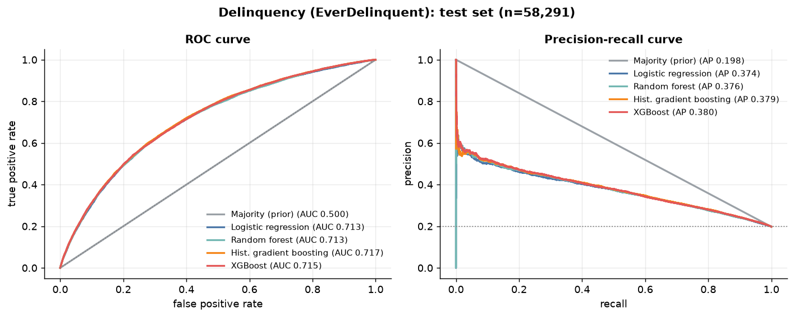
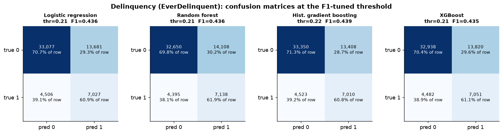
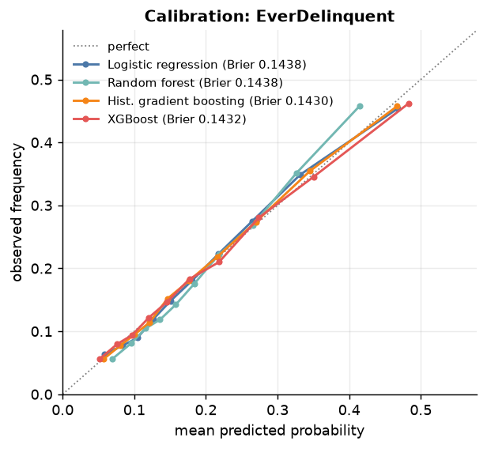
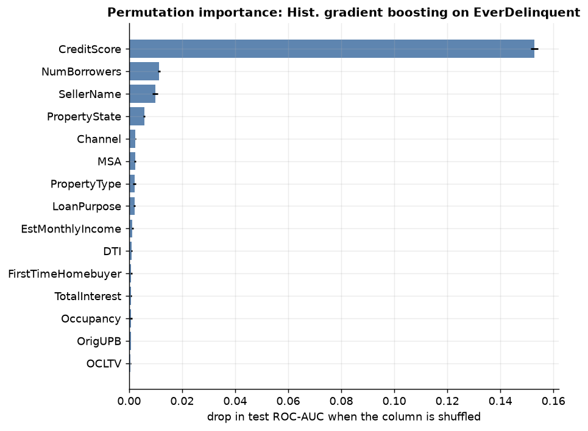
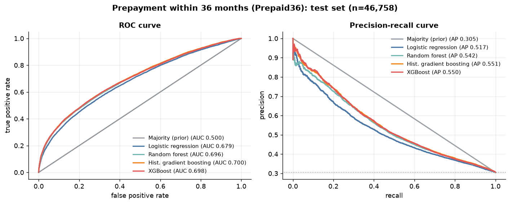
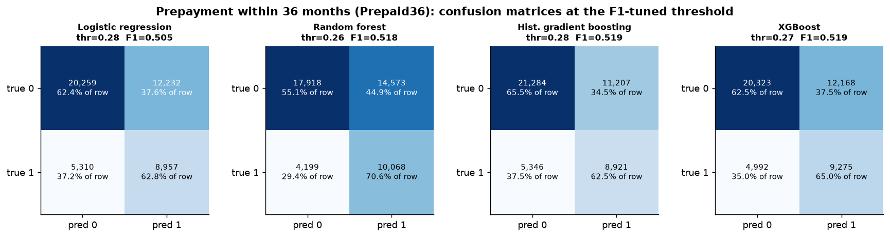
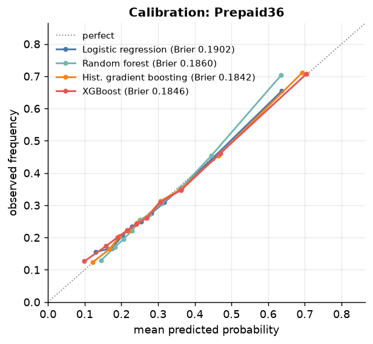
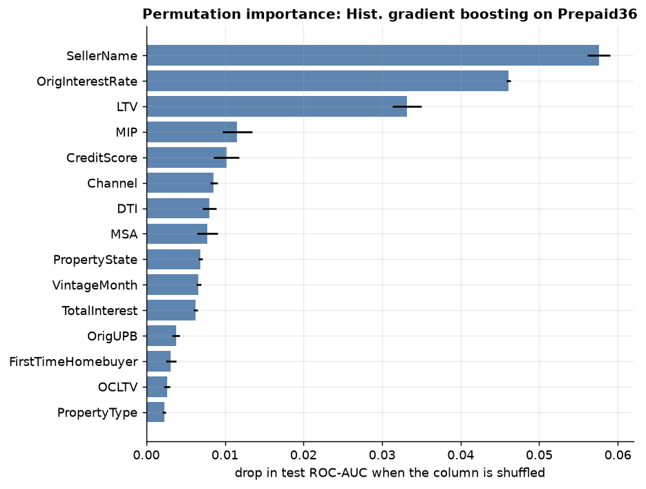
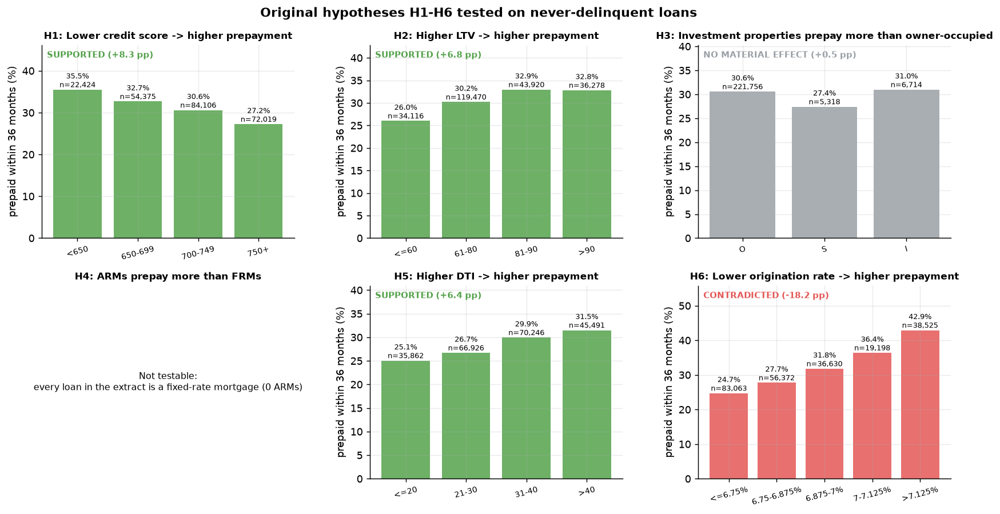
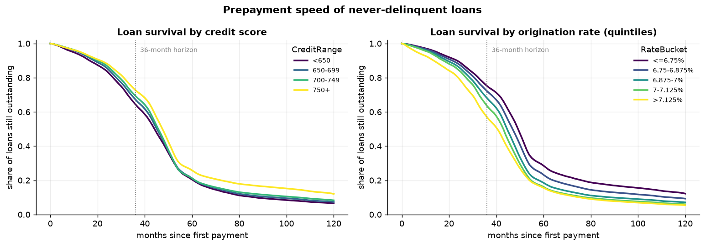

# Results

Full data: 291,451 loans. Stratified 64/16/20 fit/validation/test split, seed 42. Test sets:
58,291 loans (delinquency) and 46,758 never-delinquent loans (prepayment). Reproduce with
`python scripts/train.py && python scripts/evaluate.py && python scripts/make_figures.py`
(about 10 minutes on 2 CPU threads). Machine-readable numbers: `reports/metrics.json`,
`reports/hypotheses.csv`, `reports/importance_*.csv`.

## 1. Delinquency (`EverDelinquent`, 19.8% positive)

| Model | ROC-AUC | 3-fold CV ROC-AUC | PR-AUC | F1 @ tuned thr. | Precision | Recall | Brier |
|---|---|---|---|---|---|---|---|
| Majority (prior) | 0.500 | - | 0.198 | 0.000 | - | 0.000 | 0.1587 |
| Logistic regression | 0.713 | 0.710 ± 0.003 | 0.374 | 0.436 | 0.339 | 0.609 | 0.1438 |
| Random forest | 0.713 | - | 0.376 | 0.436 | 0.336 | 0.619 | 0.1438 |
| **Hist. gradient boosting** | **0.717** | 0.713 ± 0.003 | 0.379 | **0.439** | 0.343 | 0.608 | **0.1430** |
| XGBoost | 0.715 | 0.712 ± 0.002 | **0.380** | 0.435 | 0.338 | 0.611 | 0.1432 |

* All non-trivial models are within 0.004 ROC-AUC of each other: the signal is almost linear
  and is dominated by one variable. Permutation importance (drop in ROC-AUC when shuffled):
  `CreditScore` 0.153, then `NumBorrowers` 0.011, `SellerName` 0.010, `PropertyState` 0.006.
* Delinquency rate by credit band: 41.1% below 650, 26.4% for 650-699, 15.0% for 700-749 and
  9.1% at 750+.
* Ranking value: the 10% of test loans scored riskiest by gradient boosting have a 45.8%
  delinquency rate, the safest 10% have 5.6% (base rate 19.8%).
* Calibration: all models are close to the diagonal (Brier 0.143 vs 0.159 for the prior).

## 2. Prepayment within 36 months (`Prepaid36`, 30.5% positive among never-delinquent loans)

| Model | ROC-AUC | 3-fold CV ROC-AUC | PR-AUC | F1 @ tuned thr. | Precision | Recall | Brier |
|---|---|---|---|---|---|---|---|
| Majority (prior) | 0.500 | - | 0.305 | 0.000 | - | 0.000 | 0.2120 |
| Logistic regression | 0.679 | 0.678 ± 0.002 | 0.517 | 0.505 | 0.423 | 0.628 | 0.1902 |
| Random forest | 0.696 | - | 0.542 | 0.518 | 0.409 | 0.706 | 0.1860 |
| **Hist. gradient boosting** | **0.700** | 0.701 ± 0.003 | **0.551** | 0.519 | 0.443 | 0.625 | **0.1842** |
| XGBoost | 0.698 | 0.700 ± 0.002 | 0.550 | **0.520** | 0.433 | 0.650 | 0.1846 |

* Tree models beat logistic regression by about 0.02 ROC-AUC and 0.03 PR-AUC: prepayment depends
  on non-linear effects (seller, rate, LTV) that a linear model misses.
* Permutation importance: `SellerName` 0.058, `OrigInterestRate` 0.046, `LTV` 0.033, `MIP` 0.012,
  `CreditScore` 0.010. (`RateSpread` carries the same information as the rate, so the two share
  credit.) One seller (code `FI`, 24,581 loans) has a 57.3% 36-month prepayment rate against
  17-31% for the others, a seller-level effect (retention / refinancing programmes) the data does
  not explain further.
* Ranking value: the top-scored 10% of test loans prepaid at 71.1%, the bottom 10% at 12.3%
  (base rate 30.5%).

## 3. Hypotheses H1-H6 (never-delinquent loans, `Prepaid36`)

| | Hypothesis | Verdict | Evidence (36-month prepayment rate) |
|---|---|---|---|
| H1 | Lower credit score -> higher prepayment | **supported** | <650: 35.5% -> 750+: 27.2% (+8.3 pp) |
| H2 | Higher LTV -> higher prepayment | **supported** | <=60: 26.0% -> >90: 32.8% (+6.8 pp) |
| H3 | Investment properties prepay more | **no material effect** | investment 31.0% vs others 30.5% (+0.5 pp) |
| H4 | ARMs prepay more than FRMs | **not testable** | every loan in the extract is a fixed-rate mortgage |
| H5 | Higher DTI -> higher prepayment | **supported** | DTI <=20: 25.1% -> >40: 31.5% (+6.4 pp) |
| H6 | Lower origination rate -> higher prepayment | **contradicted** | rate <=6.75%: 24.7% -> >7.125%: 42.9% (-18.2 pp) |

All chi-square p-values are below 1e-5 (n = 233,788), so the verdict uses a 2-point effect-size
rule. H6 is the strongest effect in the data and goes the opposite way: a borrower who locked in
a *high* rate has the most to gain when market rates fall (2001-2003), so high-rate loans prepay
fastest. H1 is partly the same effect, since low-score borrowers pay higher rates.

